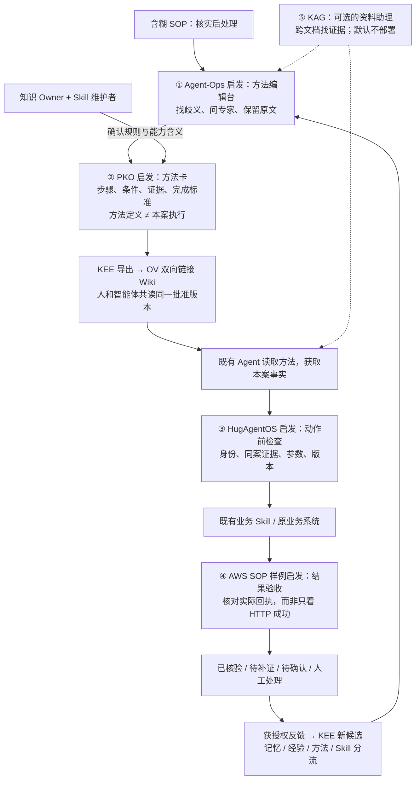
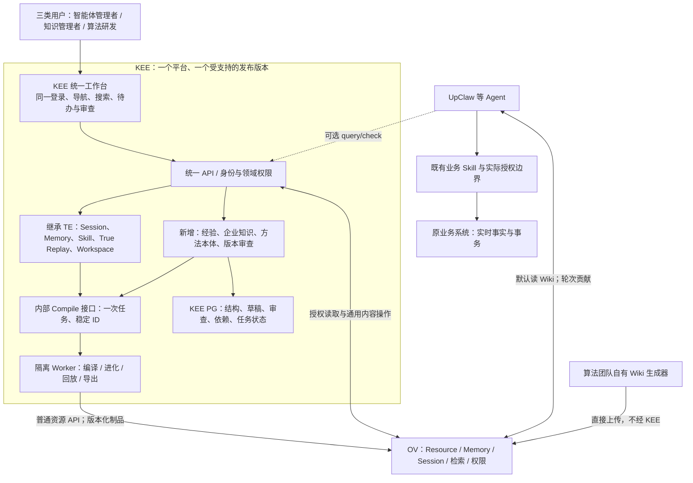
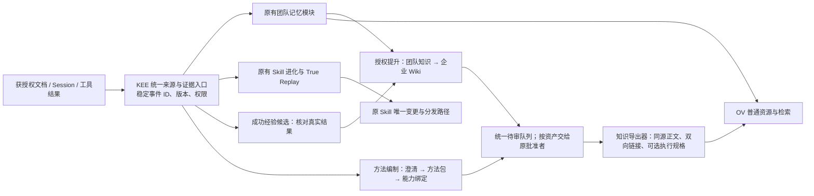

# 本轮实施口径：R6 简化版本（2026-10-08）

本节为源码实施后的修订提案，待本人审核。下方原 R6 全蓝图完整保留，不能将其中设计全部当作本轮实现。

1. 本轮范围为统一 KEE、方法治理和 Wiki 发布；不修改 UpClaw，不接实际工具／Skill 调用前检查及调用后核验，不加跨平台可靠投递、事件总线或第二套 Session/Judge。因此原文有关 UpClaw 拦截、可靠轨迹及执行效果核验的章节是后续设计，不属于本轮验收。
2. 三视角当前只重排六导航，权限依旧校验真实租户和角色；方法编制是同屏结构 JSON、冻结证据、澄清文本与审核意见。复杂逐项澄清、完整语义 Schema 校验和自动依赖补编译未完成。
3. 新方法由 KEE 内部隔离 Worker 编译；结构、批准和检查点复用既有 PG objects／任务／审计。Memory 适配受限正文输出，不执行工具型 Skill；通用知识库挖掘仍保留原 OV Compile 兼容路径。
4. 同一批准结构确定性输出 Wiki，OV 负责通用内容、权限与索引。OV 无包级原子提交，不能宣称切入口相当于跨系统事务。可选 query/check 默认关闭、不列入 MCP，仅作有界静态结构读取，不提供执行授权。
5. 本地 PG／HTTP 桩／模型子进程桩流程通过；全量 Python 尚有4项已有失败。真实模型凭据缺失，新版完整浏览器受控制通道阻塞，真实 OV 与外部 True Replay Runtime 未验证。本轮未部署、未 push，也未迁移生产历史资产。

详见 [09 源码基线与功能矩阵](09_KEE_R6简化实施_源码基线与功能矩阵_20261008.md)、[10 契约与恢复](10_KEE_R6契约接口与迁移部署恢复_20261008.md)、[11 验收与待办](11_KEE_R6本地验收与待办_20261008.md)。

---

以下为原 R6 全蓝图，仅保留作设计历史。

# KEE 知识进化平台：把方法、记忆与能力放在一个工作台
## R6｜原 TE 与 KEE 合并，OV 继续作为通用上下文底座

> 2026-10-08｜面向智能体管理者、知识管理者与智能体算法研发。  
> 本版依据用户本轮组织决定，在 R5 上更新产品、架构、交互和实施安排。它是工程设计，不是代码已合并、数据已迁移或性能已验收的报告。  
> 资料约束：保留五项研究的原有定位，明确区分原研究、本文借鉴方案与待实现能力；来源见第十二节。

**用户只面对一个 KEE 平台。平台里整理方法、维护记忆、改进 Skill；智能体通过 OV 读取知识，再用既有业务工具办事。**

算法平台团队暂不承接 TE，原 TE 与原 KEE 不再为部门边界拆成两个产品。统一名称为 **KEE（Knowledge Evolution Engine，知识进化平台）**。teamEvolver 作为上游来源和技术实现继续保留，不再是另一套用户入口。

合并不等于推翻重写。原有团队记忆、Skill Evolution、True Replay、Workspace、SkillMiner 等功能完整继承。新增加工、本体与知识运营模块接入同一工作台。**统一产品和控制面，计算任务仍可分 Worker 隔离。**

## 1. 哪些决定改变，哪些不变？

| 议题 | R6 决定 |
|---|---|
| TE 与 KEE | 合为 KEE；取消为两部门交接而建设的双登录、双导航、互调业务 API 和重复状态展示 |
| 团队记忆与 Skill | 保留现有实现及唯一变更路径，成为 KEE 内部模块；不能复制一套新版替换已用功能 |
| Compile | 从 OV 的通用知识存储职责中抽离，成为 KEE 内部执行模块；可独立 Worker，但不是第三个产品 |
| Ontology | 结构、方法、条件、能力绑定及工作台都在 KEE；优先表达处理方法，不汇总全企业逐单数据库 |
| OV | 只负责通用资源、Memory、Session、检索、权限、内容和索引任务；不恢复本体表、规则引擎或专用语义路由 |
| 默认 Agent 接入 | 通过 OV 读当前版本的双向链接 Wiki；KEE query/check 仅在明确需要时使用 |
| 算法团队直接发布 | 继续允许其自行构造并审核 Wiki，直接上传 OV；无需 KEE 数据库、包 ID 或审批接口 |
| 业务动作 | 继续由原 Agent／Skill／业务系统授权和执行；知识批准、模型解释、check 结果都不是动作许可证 |
| 普通员工阅读 | 保留企业知识只读入口，内容从 OV 取得；它不是管理控制台的第四种管理员身份 |

R4/R5 中“保留 TE 上游功能”的要求继续成立，改变的是产品与部署归属，不是把这些功能删除。组织以后再变化，也不能因此自动拆服务；是否拆分应由负载、发布节奏和真实责任需求决定。

## 2. 五项研究怎样用在同一件事上？

### 2.1 用一个简化业务例子串起来

客服提出：“系统显示已签收，客户说没有收到。请核实并按流程处理。”这只是解释方案的模拟案例，不代表实际签收、赔付或归责制度。

现有 SOP 可能只写“核实后处理”。我们缺的不是更长的回答，而是：核实哪个对象？取什么证据？哪个结果允许走下一步？哪个工具能做？怎样知道事情真正完成？

五项研究各帮助处理一处缺口：**Agent-Ops 把说明写清，PKO 把方法定义清楚，HugAgentOS 启发调用前检查，AWS 样例启发调用后验收，KAG 在必要时帮助找齐证据。** 它们不是五个串行必调服务。

### 图 1｜把五项研究放到“设计台—办事现场”

图中编辑台、方法卡、检查与验收是本项目的职责设计，不是五个项目已经官方互接的架构。实际工具权限和业务事务一直留在原系统。

### 2.2 Agent-Ops：先做“方法编辑”，不要直接画流程图

**原研究支持什么。** Agent-Ops 的 SOP Groomer 针对含糊、不完整的 SOP，引入人机共同澄清和方法整理。论文的业务是电商运营；本轮没有确认其完整系统可直接作为开源产品部署。[W1][S1 §7、§11]

**我们怎样借鉴。** 在 KEE 的“知识与方法”中加入澄清区。模型先找出原文中没有说清的地方，产生 `ClarificationItem`；每条绑定来源版本、原文位置、问题、候选解释、影响步骤和处理人。模型可以提问题，不能自行把猜测变成正式条件。

例如，“核实收货”拆成“核实系统签收记录”“核实客户陈述”“核实证明是否属于本票”。业务专家确认含义；Skill 维护者确认哪个工具返回这些信息，以及空结果、无权、超时各是什么意思。

**具体产物。** 一组可处理的澄清项，加一份整理后的方法候选。阻断性问题未解决时，分支只能作为说明或人工处理指引，不能标成自动执行就绪。界面同时显示“可阅读”和“可用于受约束执行”，不混为一个绿色状态。

**验收。** 同一份含糊 SOP 必须定位缺口而不是补造门槛；专家改动影响的步骤、条件和页面能被追踪。未知材料无需阻断所有独立内容，但要阻断依赖它的自动分支。

### 2.3 PKO：借“工艺卡”，明确方法与执行的区别

**原研究支持什么。** PKO 是流程知识的语义资源，区分 Procedure／Step 与 ProcedureExecution／StepExecution，帮助描述方法及其使用。它不是现成的业务运行引擎。[W2][W3][S1 §4]

**我们怎样借鉴。** `ProcedurePack` 保存“应该怎样做”，包括目标、适用范围、步骤、前置证据、分支、所需能力、完成标准和人工出口。既有 Agent 的运行记录保存“本案做了什么”，引用固定的方法和绑定版本。

方法里有“检查证明”一步，不代表本案已检查；某个 Skill 已调用，不代表结果满足条件。页面和接口都要保留这些区别。概念可以对齐 PKO 的小子集，不必把全部运行数据转成 RDF，也不必为了采用 PKO部署图数据库。

**具体产物。** 版本化方法包与步骤定义；运行侧最少的步骤实例引用；方法页、条件页、能力页和证据页的稳定 ID。借 PKO 的定义／执行语义，等待、幂等、业务条件与权限由我们按现有系统补齐，不能归为 PKO 原生保证。

**验收。** 两个个案使用同一方法版本，执行进度与证据不互相污染；方法变更不会篡改旧个案记录；方法发布时间与规则适用时间分开。

### 2.4 HugAgentOS：借“动作前检查”，而不是只借提示词

**原文档支持什么。** 其领域包关联概念、关系、约束和工作流，描述工具执行前的确定性检查及父子 Agent 的治理上下文。文档同时允许用户关闭本体校验；这是该产品的可选机制，不是我们的强制业务边界。[W4][S1 §5]

**我们怎样借鉴。** 在现有 Agent／Skill 的实际调用入口补薄适配。针对试点方法核对真实主体、对象 ID、参数、证据来源与时点、方法／绑定版本及当前授权。只检查聊天中“出现过查询工具”远远不够，必须确认其结果属于本案且支持该分支。

例如，Agent 取到了 A001 的材料，却请求处理 A002，入口必须拒绝。父 Agent 调子 Agent，大 Skill 再调用内部 API，都不能因为最外层通过检查就豁免后续实际写入。

**具体产物。** `CapabilityBinding`、调用前结果报告和审计引用。输入字段按当前方法映射，不要求全企业统一改库表。企业强制规则不能由普通用户关闭；模型输出的 `verified:true` 不能成为可信证据。

**验收。** 跨案、过期、缺字段、拒绝访问、分页不完整和方法撤回均有负例。KEE query/check 可以不接，但原有动作授权一直有效；选用远程 check 的受约束动作，在不可用时不能让模型自行放行。

### 2.5 AWS SOP Agent for Telco：借“验收单”，证明动作的真实结果

**原样例支持什么。** 官方样例将 SOP 步骤、预期输出、工具执行和结果评估连起来，并明确是示例而不是生产就绪系统。我们不复用其中宽泛的基础设施工具权限。[W5][S1 §6]

**我们怎样借鉴。** 给每个会产生业务变化的步骤补 `ExpectedResult` 与结果核验方式，作为方法包和能力绑定的字段，不另造一套独立“验收平台”。返回请求受理号仅表示受理；有后台处理时继续按原业务协议查询，直到确认结果或进入待确认。

例如，请求创建补证任务后，响应丢失不能直接再创建。先用原幂等键或受控结果查询确认是否已生成任务；没有安全对账能力，转人工。具体业务 API 名称要盘点，不能由示例编造。

**具体产物。** 四项分开的状态：调用发起、调用成功、结果支持条件、业务效果核验。核验引用真实回执或状态，不把模型裁判的好评当业务完成。

**验收。** “已提交但响应丢失”“处理中”“重复消息”不会触发重复动作；无法核验不计成功经验。DAG 可用于无环子步骤，等待补证、挂起和重试仍用既有持久运行状态表达。

### 2.6 OpenSPG／KAG：借“资料助理”，没有证据缺口就不要增加依赖

**原项目支持什么。** KAG 结合 Schema 约束、知识组织、检索和逻辑形式求解；官方文档提供 MCP 接入。它的检索问答能力不等同业务执行器或生产审批系统。[W6][S1 §3]

**我们怎样借鉴。** 先做普通 OV 检索与双向 Wiki。若“某地区适用条件”散落在多份制度、别名导致规则错配或证据链经常缺段，再以离线构建或可选检索插件做对照。

KAG 返回候选方法、证据路径和缺口，不拿业务写权限。其索引必须由授权发布版本重建，带内容版本和可见范围；不在 OV 建本体表，不形成独立可编辑的知识主库。

**具体产物。** 首期只预留检索扩展接口和一组能暴露缺口的测试，不部署 KAG。只有实验显示质量改善足以抵偿时延、模型和运维成本，再启用。

**验收。** 相同模型、权限和问题集比较普通 Wiki 与增强调用。不要同时加 query/check 和 KAG 后把全部收益归给“本体”。

## 3. 合并后的 KEE 怎么组织，才不是把所有代码揉在一起？

### 图 2｜一个产品、一个控制面、分工明确的模块

**产品合并不是全局字符串替换。** 建议以现有二开 teamEvolver 仓库为主干承接 KEE；若独立 KEE 已建成，先盘点真实差异再并回模块。保留 Git 历史、上游 remote、Python import、现有数据库 schema、原 Skill ID 和已有 API 兼容。对外品牌可以统一，内层名字暂不动。

新模块通过内部应用接口调用现有功能，不在同一平台内绕一圈 `HTTP TE → HTTP KEE → HTTP TE`。API 进程不做长编译；Worker 复用同一代码与发布版本，根据任务类型分池。必要的进程隔离不等于重新拆成产品。

### 3.1 先保留唯一写者，再统一展示

| 资产 | 唯一维护路径 | 不能发生的事 |
|---|---|---|
| 团队 Memory | 原 team_memory／聚合／DreamCycle 实现，成为 KEE 的记忆模块 | 新建第二个聚合器同时写同一目标 |
| Skill | 原 SkillMutationService 及其真实版本、验证和分发路径 | 通过本体编辑器或普通文件保存直接发布 Skill |
| 方法本体与企业 Wiki | KEE 知识模块审查；发布器向 OV 交付普通文件 | 给 OV 加结构库，或同时允许结构与导出正文独立编辑 |
| 成功经验 | KEE 经验模块；消费获授权实际结果，形成候选 | 将原 Evidence/Judge 全部搬掉，或把模型自评当成功 |
| 个人工作记忆 | 迁移前原路径，迁移后明确一个 scope 维护者 | 原 mem0/MemTree、OV 原生提取和新任务同时生成同一份记忆 |
| 业务事实与事务 | 现有业务系统和 Skill 入口 | 将逐单状态变成 KEE 的另一个业务主库 |

同一个任务中心可以显示多种运行，但不强制重写所有上游任务引擎。用只读适配统一“阶段、目标、产物、阻塞、下一步”，具体状态仍有原权威。共享事件去重和协调以后逐步补齐，不用一个新的 `success` 字段抹掉差异。

### 3.2 存储边界

KEE 保留现有运营／Skill 存储，新增本体结构、澄清、方法版本、绑定、审批、页面依赖与执行任务记录。新增迁移可并入同一 PG 的独立模块表，运行角色与迁移角色分开；不为更名自动搬表、改租户 ID 或授予更高权限。

OV 保持原件、已交付 Wiki、Memory、Session 与通用元数据。原 Skill 注册表在哪，以现有实现为准；统一入口不等于本轮完成资产真源迁移。跨 KEE/OV 不使用共库 JOIN、共享 ORM 或可写 NAS 根。

个案状态沿 Agent／业务平台现有持久记录保存。KEE 保存必要引用和脱敏反馈，不集中复制所有客户资料。个人生活数字分身不进入企业加工范围。

## 4. 首页先回答“我该做什么”，而不是展示内部模块

### 4.1 三类用户不是三套系统，也不是角色切换即可提权

| 用户 | 首页重点 | 主要动作 | 默认不展示 |
|---|---|---|---|
| **智能体管理者** | 我的智能体、待验证能力、接入异常、版本影响、运行风险 | 连接智能体，选择知识与能力范围，查看回放，批准其有权批准的发布或回滚 | 本体 JSON、数据库路径、编译内部参数 |
| **知识管理者** | 待处理来源变化、待澄清问题、待审版本、过期或被撤回的知识 | 对照原文、回答澄清项、编辑方法、审差异、发布知识、处理反馈 | 模型日志和代码配置；需时可展开 |
| **智能体算法研发** | 实验、数据集、失败样例、方法/绑定变更、质量与成本对照 | 调整抽取与编译策略，管理 Schema/绑定，跑 A/B 回放，检查轨迹和接口 | 自动授予生产发布权或他人私有记忆权限 |

一个用户可以承担多个职责。“切换工作视角”只改首页和快捷入口，不增加后台权限。操作还受租户、领域、对象 Owner 和环境限制。普通阅读者只有知识浏览授权，不因进入 KEE 就可运行实验或修改规则。

### 4.2 六个一级导航，功能名用用户语言

| 导航 | 用户能找到什么 |
|---|---|
| **工作台** | 我的待办、最近操作、可继续任务、异常与影响提醒 |
| **智能体与能力** | 智能体接入、Skill、个人／团队记忆、知识绑定、版本和使用记录 |
| **知识与方法** | 来源文档、企业 Wiki、成功经验、处理方法、术语关系及来源对照 |
| **进化与实验** | 团队记忆维护、Skill 进化、Compile、历史回放、数据集与对照结果 |
| **审查与发布** | 待审、差异、已发布版本、撤回、回滚与审计 |
| **设置与接入** | OV 连接、模型与预算、账户和领域权限、发布来源、API/MCP接入 |

算法研发在“知识与方法”的高级区看到“Ontology／结构模型”；知识管理者先看到“处理方法”“适用条件”“证据要求”。首次出现术语给短解释，而不是把所有内容改成模糊的非技术标签。

已有 TE 上游功能必须可达：Workspace 并入智能体与能力／知识浏览，Memory/Skill Lab 和 SkillMiner 归进化与实验。做路由映射和功能回归，不能因为菜单变短就删除能力。

### 4.3 最重要的三个页面

**知识详情与审查页。** 顶部显示名称、状态、Owner、适用范围和当前版本。中间可切“阅读／变更／来源／影响／历史”；变更区左侧原文与来源位置，中间候选变化，右侧问题、验证与审查意见。知识管理员默认阅读语义差异；研发可以展开 JSON diff。批量审查不支持无差别“一键全通过”。

**智能体接入与能力页。** 用“连接 → 选择范围 → 验证 → 启用”展示进度。连接成功、能检索、轨迹已接收、知识已生效分别验证。默认只启用 OV 普通读取；KEE query/check 在“高级接入”中明确开启。

**实验对照页。** 同一个问题并列显示 Baseline/Candidate，标明模型、输入、工具、方法和数据集版本。先展示完成标准是否达成，再显示成本与时间；隐藏验收项不能下发给候选执行器。Judge 不可用显示“无法判定”，不得显示 0 分或通过。

### 4.4 交互状态必须说人话

任务用“读取资料—生成候选—待澄清—验证—待审查—正在发布—可供使用”表达阶段。内部 job/step/task ID 放在详情里。资料不足、无权、部分失败、取消结果未知和仅索引未完成要有不同提示及下一步。

例如：“正文已上传，检索仍在更新。无需重新生成。”提供“查看处理进度／核对状态”，而不是一个会重写全文的“重试”按钮。状态未知时先对账；重复点击同一动作由服务器幂等保护。

表单自动保存草稿，离开提示未提交修改。错误保留输入并指向字段。危险动作展示影响范围和回退方式，批准后内容变化使旧批准失效。提供键盘操作、清晰焦点、非颜色状态标记、长任务可离开后恢复、无权限与无数据两种空态。

### 4.5 一次真实感操作，三个人各做一步

举一个简化协作场景：一份处置说明增加了例外条件。知识管理者在待办中打开差异，定位原文并确认影响的步骤；研发用冻结案例跑对照，检查旧方法是否会误走分支；智能体管理者查看影响到的助手和能力版本，按自己的权限安排启用。三个人使用同一对象与版本，不复制文件、不反复贴任务 ID，也不互相代授权限。

## 5. 从来源到可用知识：合并后怎样流转？

### 图 3｜一个平台内的业务流，不再是 TE 与 KEE 互调

“统一待审队列”是聚合不同资产的操作入口，不强迫所有资产共用一个发布事务。团队 Memory 当前更新／快照、Skill 版本、Wiki 发布与索引各有状态。实现时按真实代码核实并保留，逐步补治理，不把所有任务都包装成已原子发布。

Session 上传与加工解耦。UpClaw 适配层追加获授权消息、工具输入输出、实际制品与使用引用，记录稳定事件键和接收回执。只采集运行时实际可获得的信息，不要求导出模型隐藏推理。当前客户端是否具有持久重放以源码验证，不能把内存队列当可靠事件日志。

同一证据可以供不同用途使用，但加工键要含用途、输入版本、Skill／规则版本和范围，避免重复收费或循环改写。团队记忆转企业知识必须经过共享许可，不以脱敏替代授权。

## 6. 方法结构、Wiki 与实际执行保持同源但不混权

继续采用 R5 四份契约：`ProcedurePack`、`CapabilityBinding`、`CaseEvidence`、`WikiRelease`。澄清项是编制记录，预期结果是方法／绑定字段，不为每个概念新建一套微服务。所有新字段和类名是工程提案，代码应先复用现有模型。[S2]

**同一批准版本生成两种可选表达：**人和普通 Agent 使用 Markdown；受约束执行需要时，提供同包普通 JSON 规格或已批准的局部检查。OV 只保存它们，不解释本体语义。结构版与正文不分两次模型抽取，否则无法保证条件一致。

双向链接由相同关系记录生成，不把关系反转成另一条业务事实。方法主页面保留关键条件、例外和完成标准，避免靠五六次跳转才能读到一条关键否定。高出度反链分页，跨权限范围不暴露隐藏对象的标题和 URI。

已批准的发布包使用不可变版本目录和清单。私有构建、回读摘要、权限核对、索引核对、开放版本和切入口分别记录。只用已确认存在的 OV 通用条件写接口；没有整包原子能力时不声称“全部原子生效”。完整目录每次复用未验证前，不宣称仅上传变化文件。

KEE 保存源→方法→绑定→页面依赖。撤回先通过 OV 通用权限或受控删除阻断使用，再更新反链、摘要和索引。只改入口不能封住旧 URI。发布者失联会延迟语义撤回，需登记值守和时延；高风险动作执行前仍确认当前方法与业务状态。

外部算法团队可直接发布 Wiki，不需要 KEE 在线。提供可独立运行的格式／链接校验器便于协作，但不强制导入 KEE。本体未登记时，KEE 返回 NOT_MANAGED，不能临时让模型猜规则。纯 Wiki 发布只是可读知识，不自动承诺业务动作可执行。

## 7. Agent 使用过程：默认走 OV，只有必要时才查结构

Agent 先获取真实身份和允许根目录，读取当前方法入口，固定一次任务的知识与绑定版本。模型可以解释问题、选择需要的资料、提出补证，不得改变已批准条件。

事实通过既有业务 Skill 获取。受信执行入口检查同案、时点、参数、方法版本与当前权限。对于读取后可能变化的事实，使用原业务系统的版本条件或事务；不能靠本地先查一次就消除竞态。

可选接口仍只有两项：`POST /kee/v1/ontology/query`／`kee_ontology_query`，有界精确字段与一跳关系；`POST /kee/v1/ontology/check`／`kee_ontology_check`，已批准的有限条件求值。首期默认关闭，配置开启才暴露工具。

check 返回 TRUE/FALSE/UNKNOWN、冲突、缺口、版本、输入摘要和依据。无权、语法错、超时是服务错误，不伪装 FALSE。调用者自报数据标 `caller_supplied`，不能因一次检查升级为权威事实。解释随结果返回，不增加 infer/compose/explain 等一串重复接口。

执行后确认真实回执。没有结果查询能力的未知提交转人工，不盲目重试。真正成功的个案可形成经验候选；失败按缺陷分给方法、绑定、工具运行或个人偏好处理，不每次都跑全库编译。

## 8. 怎么落地，不破坏已用功能？

| 工作包 | 交付重点 | 放行条件 |
|---|---|---|
| **P0：真实现状盘点** | 定位授权仓库、当前 commit、upstream、配置、数据库和已实现 KEE；记录原功能与测试基线 | 不猜项目路径，不将 R3—R5 方案当代码；不覆盖用户未提交修改 |
| **P1：统一 KEE 外壳与内部边界** | 一个登录、品牌、导航、搜索和权限上下文；内部服务接口；老 URL/CLI/包名兼容 | 原 team_memory、Skill、Replay、Workspace、Miner 行为仍可达；无内部自调用环 |
| **P2：三类用户的实际操作** | 工作台、知识详情与审查、接入向导、实验对照；接真实 API 的页面 | 空态、错误、权限、部分完成和恢复路径能测试；不是只有静态图和假按钮 |
| **P3：方法结构与编制** | 澄清项、四契约、小型领域结构、版本与绑定；query/check 特性开关 | 歧义有责任人；缺来源不补造；审批绑定内容版本 |
| **P4：Wiki 发布纵切** | 确定性导出、正反链、权限、不可变制品、当前入口、索引对账、撤回 | 不改 OV 本体库；外部生成器可不经 KEE 发布；结果未知不重复写 |
| **P5：继承进化与新增流程** | 原 Memory/Skill 模块接内部 Compile；成功经验与企业知识提升 | 每类资产唯一写者；输入共享获授权；原验证和 Skill 发布路径保留 |
| **P6：回放与执行适配** | 复用 True Replay，做一个已有 Skill 的薄检查与后验核验 | 测试不写生产；同案、版本、未知提交、重复动作负例通过 |
| **P7：迁移与交付** | 本体扩展迁到 KEE；RAG/个人工作记忆分 scope 灰度；部署、容量和恢复脚本 | 迁移前备份/干跑/对账；旧写者退出有证据；破坏性操作另行批准 |

默认先交付一个从“导入来源—澄清—审核—发布 OV—Agent 使用—结果反馈”贯通的业务域，再扩大规模。不要求第一期集成 KAG，也不要求全量库表本体化。

已执行的 R3/R4 拆分才需要合并迁移；尚未执行的计划直接废止，不为“取消拆分”反而新增搬家任务。代码合并优先扩展现有二开仓库，不新建空 KEE 工程复刻 TE。若独立仓库存在，按真源、版本、ID 和依赖清单迁入，不简单拼两个数据库。

## 9. 性能与部署：一个平台不代表一个进程

KEE API 保持交互响应，Compile、记忆进化、Replay 和导出用受限 Worker；OV API/通用后台继续分担在线与索引负载。先沿用当前可验证任务协议，必要时给进程内状态补持久化和单写者，不先重写整套队列。

**不再需要两个控制面常驻，却不能据此直接承诺资源下降。** 合并后的内存、连接池和任务负载仍在；减少的是重复会话、互调、同步和运营成本，实际收益要测。

供首域测试讨论的起配：KEE API 2×4 vCPU/8GiB，Compile/导出 Worker 2×4/8，进化/回放 Worker 1×4/8，OV API 2×4/8，OV 通用 Worker 2×4/8；合计9个应用单元、36 vCPU/72GiB。**这是含进化池的规划预算，不是采购单或容量保证**；PG、Redis、NAS、模型、外部运行时、观测和备份另计，单回放进程并不具备任意故障下自动续跑保证。

一次任务总耗时由模型、检索、跳页、业务调用和核验共同决定，不将分步骤 P95 相加作总 P95。测量将轮询/健康检查与业务请求分开，失败率、超时与尾部延迟单列。模型配额在整个 KEE 集群共享，子任务不重新获得整套预算。

压测分100/1,000/10,000来源逐级推进，变化量以1%/5%/10%作假设。对结构到 Wiki 的纯导出，可用合成有向关系验证性能；真实模型批处理必须有明确额度。未变化的结构无需再调用 LLM，完整版本目录可能仍需写入，费用和写放大分别计量。

多实例前核实任务恢复、运行锁和连接总预算；不是把副本数加到2就保证高可用。发布使用就绪检查、停止领取与排空；回滚包含新增数据、撤回和索引状态，而不仅是镜像版本。

## 10. 用户体验与技术正确性一起验收

| 场景 | 必须看到的结果 |
|---|---|
| 三类用户首次进入 | 各自找到相关待办与主要任务；不需要理解 TE/KEE/OV 内部路由 |
| 视角切换或直接访问后台 API | 视角只改布局；没有对应领域权限仍被服务器拒绝 |
| 原生功能访问 | 原团队记忆、Skill 发布、Replay、Workspace、SkillMiner 不丢失；一个资产没有第二写者 |
| 资料缺口和无权 | 有区分的提示、来源与下一步，不用空列表伪装服务失败 |
| 草稿修改后审批 | 原批准失效；不能审核A后发布B；双击发布只产生一次业务提交 |
| 正文已上传、索引未就绪 | 页面准确显示状态，“重试”不重编译或重写正文 |
| 公共页与私有反链 | 目标正文、标题、URI、邻接和搜索片段均不越权 |
| 同案与来源版本 | A001的证据不能满足A002条件；未知、旧数据、冲突不会肯定放行 |
| 业务提交响应丢失 | 原键对账；没有证据不重复动作，不记成成功经验 |
| 本体服务关闭 | 普通OV阅读和外部上传继续；依赖远程check的动作按策略停下 |
| OV 初始化与升级 | 无本体专用表、路由、MCP或Worker；通用PG/索引/Session仍正常 |
| 回放不可用或基线失败 | 明确报告，不删测试、不改成功标准；保留失败证据 |
| 前端基本可用性 | 桌面与窄屏不裁关键按钮，键盘可操作，标签完整，刷新可恢复任务 |
| 迁移与长稳 | ID/权限/版本/撤回对账；后台故障可恢复，个人记忆删除不复活 |

实验仍按 A=原 SOP，B=澄清＋Wiki，C=B＋绑定和调用检查，D=分别增加 query/check 或 KAG。固定模型、证据、工具和权限；隐藏验收集与候选研发分离。分支正确、真实完成、合理拒绝、转人工和费用分别报告，不用一个平均分掩盖越权。

## 11. Codex 应收到什么样的任务？

配套《KEE R6 落地 Codex Prompt》是自包含任务说明。它要求先读取真实仓库和测试，再按 P0—P7完成代码、页面、接口、迁移与回归，不停在计划或静态演示。未提供的私有环境、真实业务凭据或模型额度，不能伪造；先完成能在本地验证的部分，其余明确标记未执行。

Codex 交付应包含：现状与上游差异清单、分阶段代码变更、真实前后端流程、四契约与示例、Wiki导出与对账、测试命令/原始结果、浏览器截图、迁移干跑/回滚、性能原始数据及验收回执。

本轮只生成方案与执行 Prompt，不启动本地仓库改动，不代表用户已经批准生产删表、数据库迁移或真实业务动作。

## 12. 来源与本轮证据边界

**S1｜用户提供的五项目研究。**《Ontology与既有Skill闭环_五项目深化调研及TE_OV方案_V2_20261001(1).md》，SHA-256 `02a1113df9d35656f5ec5e613d9ec60ffb63e958e5679acffdde9237ec8c2d53`。采用方法语义、澄清、执行约束和后验核验；不沿用其中已过时的 TE/OV 本体分工。该材料是研究，不是我们的生产效果。

**S2｜R5 基线。**[知识库 R5](viking://user/telegramuser8685262224/resources/documents/顺丰工作/知识进化平台/07_知识进化系统_方法Wiki与既有Skill协作蓝图_R5_20261002.md)，SHA-256 `66118ac86e42ce2fabf38c95ffd6fec534cd46d3d136dff8476186557ed4f360`。本轮全文回读，保留 OV 通用、Wiki-first、外部直传、最小接口和动作授权边界；三服务组织划分由本轮用户决定替换。

**W1｜Agent-Ops。**[ACL论文页面](https://aclanthology.org/2026.acl-industry.29/)。本轮核对题名、摘要与 SOP Groomer 定位；未重新复现论文或读取完整实验附件，不复述量化收益作为选型保证。

**W2/W3｜PKO。**[论文](https://arxiv.org/html/2503.20634v1)、[作者仓库](https://github.com/perks-project/pk-ontology)。核对流程语义及资源定位；本轮不宣称对所有版本类和公理做了差异审计。

**W4｜HugAgentOS。**[领域本体治理与校验](https://github.com/ZJU-REAL/HugAgentOS/blob/main/document/zh-CN/modules/ontology-harness.md)。核对工具前检查、可选开关及治理上下文的文档设计；未审计其所有代码或将其许可视为无条件可复制。

**W5｜AWS样例。**[Sample SOP Agent for Telco](https://github.com/aws-samples/sample-sop-agent-for-telco)。核对示例定位、预期输出及结果评估流程；模板单文件直接获取失败，不据此增加其实现保证。

**W6｜KAG。**[官方仓库](https://github.com/OpenSPG/KAG)。核对知识组织、检索与MCP入口；不引入其云端服务或默认部署。

**W7｜teamEvolver。**[官方仓库](https://github.com/leoriczhang/teamEvolver)。本轮取得官方搜索缓存中的功能和技术结构，直接页面获取失败；未固定实时 main commit。既有功能清单需要 Codex 对当前授权源码再核对，不能把缓存页面当完成审计。

本轮补充查阅一手资料，但没有运行五项目、实施代码合并、迁移数据、调用真实模型压测或验证生产业务。本文中的模块、界面、契约、图和资源预算均是建议。资料的历史目标与本轮新决定分开保留，不删除 R1—R5。

归档目标：`顺丰工作 / 知识进化平台 / 08_知识进化系统_统一KEE平台与三类用户蓝图_R6_20261008.md`。

