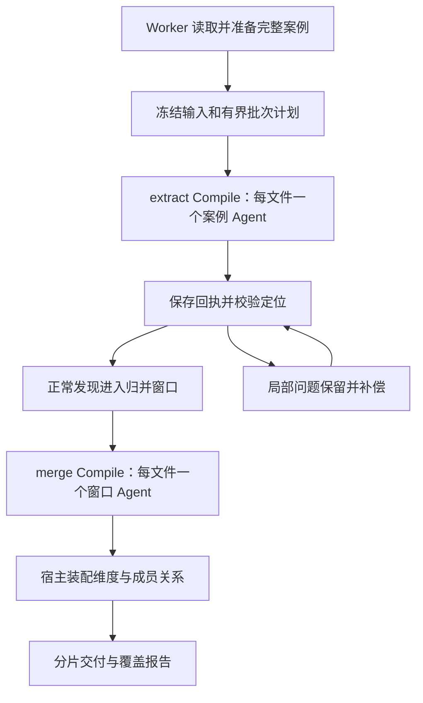

# S0 实现方案与验收

## OV 实际契约核对与修正（2026-11-10）

核对对象为本机运行服务对应的 OpenViking 源码，目录为相邻项目 `OpenViking/`。
以下均来自实际实现，不以宿主 fake 的行为作为 OV 协议证据；不修改 OV。

| 环节 | 实际规范与证据 | S0 实现要求 |
| --- | --- | --- |
| 请求 | `openviking/service/compile_service.py:CompileRequest`、`_normalize_request`；`openviking/server/routers/compile.py:create_compile` | `from` 是非空目录数组；`to` 为可写目录（允许不存在）；`skill` 是含 SKILL.md 的 Skill 根目录或该文件 URI。请求只使用 `from/to/skill/instruction`，不发明字段。 |
| 源枚举 | `bot/vikingbot/compile/service.py:_list_source_files` 递归枚举目录正文 | 每次提交创建独立、确定性、有界的输入目录，里面只有本次未接受的完整案例 Markdown，或一个完整归并窗口 Markdown。禁止传单文件 URI，禁止用全部 model_cases 目录代替一批。目录在 Compile.to 外。 |
| 文件原子性 | `bot/vikingbot/compile/ops/map.py:run`、`plan.py:Transform`、`sources.py:split_source` | Transform 必须为 `execution=agent/input_unit=file/output=files`；同一 URI 的 ranges 按 start_char 排序后交给一个 child，完整阅读，不将一个案例拆成多个业务 child。 |
| Entry / Planner | `bot/vikingbot/compile/entry.py:EntryResponse`、`plan.py:parse_plan` | Entry emit `needs_pipeline=true, files=[]`；Planner 返回 contract 与一次 Map、一次 Finalize，不要求 Shuffle / Reduce。 |
| 交付 | `bot/vikingbot/compile/results.py:FileResponse/FileDraft`、`schemas.py:result_schema`、`file_ops.py` | emit 外壳为 `files` 数组，每项含相对目标的 `path`、完整 JSON 字符串 `content` 或 scratch `content_ref`、实际 assignment 顶层输入 ID 数组 `inputs`；业务 JSON 不能直接充当 emit 参数，不能使用 RecordDraft 的 ready_* 字段。JSON 原样文件不要求 Wiki frontmatter。 |
| 幂等 | Compile 路由 header 校验、`compile_service.py:create` 的 submission recovery | Key 长度 16–128，仅字母数字及 `:._-`；先持久化请求与键。超时/丢回包以原键查 submission，404 后仍以原键 POST；不得把未知接受状态认定为拒绝。 |
| 持久化 | content batch-write 的 `mode=create/defer_processing=true` | 摘要核对后完整写入，已有同文复用、异文拒绝；只接受 semantic/vector deferred 确认，不重复触发向量化。 |
| 请求拒绝 | `_normalize_request` 在创建 task 前校验目录 | 明确 400/401/403/413/422 保存脱敏 HTTP 状态与具体原因、释放槽位、停止本任务自动提交，不能继续重试所有批次。409 等不明确状态保持原键对账。 |
| 恢复 | 宿主 `dialogue_dimensions/recovery.py` 与原有 resume 按钮 | 原按钮为对话任务自动生成并在重试时复用 request_id；部分交付新建 recovery epoch，仅补缺失案例，保留历史交付；清除旧拒绝标志。无需新按钮、模式选择或附件输入。 |

已失败任务 `ovmine-ba8cc432fd7fb7a9c5c3cf61dbbda4c8` 的原请求把案例文件作为 `from`。
源文件实际 stat 为 `isDir=false`，与上述前置校验冲突；35 个提取批次均 rejected，task_id 为空、
已分析 0 条。旧日志未保留原始 HTTP body，因此这里只确认文件/目录契约错误，
不声称已获得原始拒绝报文或后续模型 emit 的故障证据。

日期：2026-11-09。本文保留 S0 设计目标；初步实现已落地，实际范围和限制见
[实现记录](04-S0实现与验证记录.md)，不能将后续扩展目标当作已完成能力。

## 1. 实现范围与执行协议

用户在原有编译指令界面保存完整 Skill，再按原有方式创建任务。正文声明 `te-dialogue-dimensions.v1` 时执行对话维度提取；使用用户保存的内容，不由后端替换为内置 Skill。v1 是现有初版编号，不另增兼容版本。

不将新任务伪装成 `te-native-mining.v1`，也不修改已有 Native 任务每轮一次 Compile 的规则。新模式允许一个业务修订版本包含多个 extract / merge 单元，每单元一次正常 Compile，局部补偿有独立 attempt。

`max_rounds` 表示人工业务修订次数，不表示案例批数、归并窗口数或 Compile 总数。S0 初次任务默认一轮；批次执行到全部完成，不受 1–5 的既有业务轮数范围限制。单元运行期限使用冻结的 `runtime_timeout_seconds`，不将整个大数据任务绑定到一次 Compile 的期限。

所有模型调用经 OV Compile 完成，不另建本地直接模型链路，不修改 OV 源码、协议、运行配置或部署。API 接收、配置快照和状态更新使用短事务；准备 XLSX、批量文件处理、Compile 轮询和输出物化都在 Worker 中执行。

## 2. 代码落点

新增代码限制在 `team_miner/skill_miner/` 及其测试；必要的现有接口、Handler 注册、预览投影作小范围扩展。生产模块单文件不超过 1000 行。

| 建议模块 | 职责 |
| --- | --- |
| `dialogue_dimensions/compiler.py` | 提供可编辑的完整初版 Skill 和阶段参数 |
| `compiler_skills/dialogue-dimensions-v1/` | 单个 `SKILL.md` 包含 extract / merge 步骤与字段契约 |
| `dialogue_dimensions/input.py` | XLSX / JSONL 白名单导入、逻辑标识、版本、完整案例与句级索引 |
| `dialogue_dimensions/partition.py` | 流式案例分批、归并窗口、容量检查和计划分页 |
| `dialogue_dimensions/orchestration.py` | 提交、对账、轮询、状态推进、取消与单元补偿 |
| `dialogue_dimensions/validation.py` | 宽松结构解析、来源关联、精确定位和问题分级 |
| `dialogue_dimensions/assembly.py` | 根据显式成员关系分配维度 ID、汇总映射、输出分片和 manifest |
| `dialogue_dimensions/state.py` | 使用现有 PG ObjectStore 保存单元状态与回执索引 |
| `tests/miner/skill_miner/` 下专项测试 | 业务正确性、故障恢复、兼容性及容量边界 |

建议新增包名和文件名属于实现组织选择，可以在保持职责边界的前提下调整。

现有扩展点：

| 现有位置 | 必要适配 |
| --- | --- |
| [api/jobs.py](../../../../team_miner/skill_miner/api/jobs.py) | 使用原有任务请求字段，仍返回 202 |
| [job_operations.create](../../../../team_miner/skill_miner/job_operations.py) | 使用保存的 Skill；从 model_cases 父目录读取数据集清单 |
| [Handlers](../../../../team_miner/skill_miner/handlers.py) / [Engine](../../../../team_miner/skill_miner/engine.py) | 根据执行协议分派新模式的提交、轮询、停止与恢复 |
| [presentation](../../../../team_miner/skill_miner/presentation.py) | 展示案例完成数、待处理数、维度数、告警和验收状态 |
| [artifacts](../../../../team_miner/skill_miner/artifacts.py) | 使用已有 `semantic_reports` 文本预览；专用物化按分片读取 |

沿用现有 `ov_compile` 编辑保存入口。用户决定运行哪个 Skill；S0 不增加选择按钮、隐藏附件或强制绑定。

不新增独立 Service 层。状态可以复用 PG `storage_objects` 和 job document，不为本版增加数据库表。若实现确实需要新增 schema，只追加新的版本 SQL。

## 3. 输入准备与 API

### 3.1 两种入口

专用准备入口支持上传 XLSX 或已有 JSONL，返回 `prepared_source_uri`、`source_id`、`dataset_manifest_ref` 与计数。推荐新增 `POST /api/mining/dialogue-datasets`，以原文件或已上传对象引用受理并返回 202；文件大时复用上传对象，而不是把全文塞进 job.create 请求。

当前通用 source.upload 会把 XLSX 转成含评价的大表，因此新模式不直接沿用该转换结果。准备模块读取原始文件、执行白名单、冻结源文件摘要和案例版本，再将模型文件写入独立 OV 目录。日志不输出完整对话和被屏蔽的字段值。

已有 JSONL 使用相同 schema，流式读取；未知字段不会自动成为模型输入。缺少可用对话的记录转入输入问题清单，保留来源行和原因，不能静默消失。

### 3.2 创建任务

复用现有 `POST /api/mining/jobs` 的请求形状：

```text
name: 业务任务名称
input_dir: 已准备且仅含模型案例文件的 OV URI
source_id: 已登记的来源标识
max_rounds: 1
runtime_timeout_seconds: 3600
```

基础预算由[数据契约](03-数据契约与Skill设计.md)定义。Worker 自动读取所选 model_cases 父目录的 Manifest 并校验完整性，不要求用户填写摘要或专用模式字段。

正常任务不会把分数或评价重新加入 `from`。接收已准备的 OV URI 时，验证清单摘要和每个文件的白名单结构，不能仅相信“目录名看起来是脱敏输入”。

`quote_mode=none` 默认不让模型生成 `quote`；如需展示原文，优先由宿主按已定位句子生成，模型的业务解释不会冒充引文。未来可选 `quote_mode=sentences`，沿用相同的逐字一致规则。

## 4. 阶段调度



### 4.1 extract

宿主按 8 条、24,000 字符、96,000 字节的联合限制组批，任何一项先达到就结束当前批。每案例输入超过 20,000 字符或整个单元容量时单独登记 `capacity_pending`，不拆对话，不用截断结果继续声称完成。

Skill 令 Entry 尽早请求 pipeline；当前 OV Entry 仍会准备该次输入，因此整个 Compile 也必须有界。不能把整个数据集提交给 Entry，再期望“需要 pipeline”自动解决全量预读。

每个 Map child 只处理一份完整案例文件，返回一个案例发现文件。没有发现时返回空数组和说明，也是有效的语义回执。宿主成功接收并验证回执后才将该案例记为已分析；源文件已上传或模型读取目录不算语义完成。

### 4.2 merge

宿主从已完成发现建立最多 12 个成员的窗口，输入成员是完整行为定义、适用条件、来源定位和必要的关系信息，不仅是标题。窗口本身也是一个 Markdown 文件，由一个 child 归并并返回显式成员关系。

归并结果可以为多个维度、保留独立成员、暂不归并或无变更，不强制缩减数量。模型必须给出每个成员的去向；有意让一个观察支持不同维度时可给多个关联，但统计按唯一案例去重。

对于已有维度，只将完整业务定义与本窗口使用的关系引用提供给模型。上千个历史案例成员关系保存在独立映射制品中，模型不需要重复阅读；这不允许缩短维度的条件或删除差异。

S0 先完成知识点分区内的有限窗口归并，不设“反复归并直到全量装进一个窗口”的循环。跨窗口近义重复作为告警允许交付，可另外建立有限补偿窗口。无论归并是否减少数量，都能完成本轮计划。

### 4.3 最终装配

宿主只负责结构和明确关系的装配，不通过名称相似、字符串距离或向量距离自行合并维度，不补写模型没有给出的业务规则。

最终维度 ID 由宿主在持久化事务中分配，映射到模型明确的成员集合；已有维度仅在模型显式指定既有目标时更新。精确重放复用原回执和 ID，不能重复增加支持案例计数。

manifest、覆盖计数、定位字段、文件摘要由宿主生成。完整维度与案例映射按文件分页；可预览叶文件目标小于 1 MiB，超出优先按完整记录分片，不截断内容。

## 5. 状态、幂等与恢复

### 5.1 存储

| 内容 | 权威位置 | 模型可见性 |
| --- | --- | --- |
| job 概要、配置 revision、当前阶段、在途单元 | PG 现有 job document | 仅当前阶段摘要 |
| 每个执行单元的计划、提交键、task_id、attempt、状态 | PG ObjectStore，每单元独立对象 | 不传全量状态 |
| 白名单案例文件、不可变输入计划页、输出、原始回执 | OV | 当前单元独立目录及完整内联 Skill |
| 可重建工作目录 | 本机临时目录 | 无权威意义 |
| 原工作簿及被屏蔽元数据 | 受控来源对象，宿主可读 | 不挂入 Compile |

复用 [State](../../../../team_miner/skill_miner/task_io.py) 的事务与 ObjectStore。新对象前缀可采用 `skill_miner/dialogue_dimensions/<job>/<revision>/<stage>/<unit>`。job 仅保留总计、计划页引用、游标和最多两个在途单元，不能持续附加所有案例 ID。

大来源清单和输出分页流式处理；以确定性单元序号定位记录，避免每次轮询枚举全部历史任务。本机缓存损坏或丢失后根据 PG/OV 重建，依赖故障时不回退本机状态。

### 5.2 受理与不确定状态

提交幂等键由租户、job、revision、stage、unit、输入摘要、Skill 摘要和 attempt 决定。先持久化提交意图，再发 POST；响应丢失后用原键对账 OV submission，不直接换键重发。

新 attempt 仅用于已经确认失败的单元或已持久化的局部补偿计划。网络状态不明不是新 attempt 的理由。成功单元不因另一单元失败重新执行。

429 或短暂故障通过 Worker 的 `available_in_seconds` 延后继续，有界重试；不在 Router 或 Worker 中长时间 sleep。默认单元最多两次补偿尝试，次数耗尽保留已有结果和具体待处理原因。

本任务受理时的容量固定，恢复不调整批次预算。输入容量不足时登记待处理；
调整容量后使用新任务，仍按完整案例分批，不能切掉原文。

### 5.3 取消与修订

沿用精确任务 ID 的取消和远端终态对账。取消受理不等于远端已停止；远端终态不明时保持租约/槽位的现有规则，不释放后重复执行。

恢复只调度 `pending`、已确认失败或明确补偿的单元。原按钮携带稳定 request_id，
部分交付使用新 recovery epoch，保留已接受案例并复用内容完全相同的成功窗口。
Skill 正文、预算或新数据修改需要新建任务；本版没有跨新数据任务的全局缓存与既有维度增量更新。

输入重导入按 `case_ref + case_version` 精确去重，来源行映射仍全部保留。同一逻辑 ID 对应不同对话时保留版本，不能把后导入记录静默覆盖成唯一事实。初次 171 条记录的逻辑 ID 组合均唯一。

## 6. 宽松验收的规则

### 6.1 分级与影响范围

| 问题 | 处理 | 是否阻断整个任务 |
| --- | --- | --- |
| 路径逃逸、来源版本冒用、冻结输入丢失/被改写 | 阻断对应单元，保留错误与其他已完成产物 | 阻止全量成功声明 |
| JSON 不可恢复解析，或当前单元没有真实回执 | 对应单元待补偿 | 阻止全量成功声明 |
| case_ref / case_version 与当前文件不符 | 能从唯一文件上下文确定则修复，否则拒绝该回执 | 未修复时阻止全量成功声明 |
| 句子 ID 错误、引文不一致、陌生来源 | 局部修复或隔离相关发现/引用，保留原提交 | 其余结果继续 |
| 只读部分案例却声明完成 | 无完整回执则待处理；不得把未读当成无发现 | 阻止全量成功声明 |
| 只有一个支持案例、定义粒度较宽、分类不够好 | 告警、保留 | 否 |
| 近义维度重复、跨窗口遗漏合并 | 告警，可后续补偿 | 否 |
| 可选字段缺失、字段顺序、合法扩展字段 | 补默认值或忽略扩展字段，保留原回执 | 否 |
| 多余 Markdown 代码围栏、单个对象代替数组 | 唯一明确时确定性解包 | 否 |
| 数字枚举类型的小偏差 | 唯一、安全地转换并记录 repair | 否 |
| 合同权益、医疗服务效果等未经确认 | 保留沟通行为，局部事实标 `needs_review` | 否 |
| 没有新增维度 | 返回明确空发现/未归并原因 | 不设固定产量门槛 |

JSON 的容错只允许安全、确定性的外壳修复。例如去掉唯一外层代码围栏、填可选空数组；不执行模型字符串，不修补被截断的业务正文，不凭猜测闭合缺失记录。

### 6.2 最小数据检查

技术性必查项目只包含：

1. 当前阶段、输出路径和文件版本属于当前单元。
2. JSON 可以解析为当前阶段可消费的结构。
3. extract 回执对应实际分配案例；merge 成员对应实际窗口。
4. 引用有确定原文定位；输出了 quote 时可以逐字比对。
5. 输入案例全部有生效回执或明确待处理状态，不静默遗漏。
6. 归并成员有显式去向，宿主能够装配并追溯。

不设置维度数量、引文数量、字数、支持案例数、业务效果分或原总分阈值。不对文案再加一个 LLM 裁判，不强制专家审批，不生成 benchmark 或 Test Dataset。

`sentence_refs` 缺失时，若能从该观察携带的原文找到唯一完整句定位则修复；没有可确定依据时将该观察标为 `needs_review`，不让整个已分析案例失败。

### 6.3 引文特殊处理

`quote` 可选，默认省略。存在 quote 时，解码 JSON 后逐字比较冻结 `dialogue_text` 的完整句跨度，区分字符与 UTF-8 字节，不能用空白归一化、繁简转换、同义词或编辑距离通过检查。

坐标偏移但原文本在当前案例唯一出现时，允许修正定位。提交的是句子中的片段时，宿主可以另生成完整句作为展示引文，保留原提交与 `expanded_to_sentence` 审计；不能冒称模型已经提交了完整句。

文本本身改写时，原始引文进入 issues，不显示为验证通过。若同时有有效 sentence_refs，宿主可从原文生成另一份精确展示文本，标明“宿主按定位恢复”，不偷偷覆盖错误提交。

不允许句子中途加省略号、修正不通顺表达、多字少字处理或拼接不连续原话。原文本来有省略号则保留，不以出现 `…` / `...` 为独立失败条件。

### 6.4 状态语义

执行状态复用现有 job 状态；另外增加以下结果字段，不发明旧 Worker 不认识的活动状态：

| 字段 | 值与意义 |
| --- | --- |
| `delivery_status` | `complete` / `partial`，是否所有计划单元已处理 |
| `validation_status` | `passed` / `passed_with_warnings` / `blocked` |
| `review_status` | `not_required` / `recommended`，业务后续查看提示 |
| `processed_case_count` / `pending_case_count` | 按真实案例回执统计 |
| `usable_observation_count` / `isolated_observation_count` | 可消费发现与局部隔离发现 |

所有案例完成、所有归并成员已处置时，job 可为 `succeeded`，即使有小问题和局部 `needs_review`。文案不足或零新增不构成必然失败。

有案例/窗口仍未处理且补偿耗尽时，job 为 `interrupted`，`delivery_status=partial`；保留已完成结果与恢复入口。结构或来源安全大问题可为 `failed`。不得用当前 completion-only 的远端完成状态覆盖专项验收结论。

正常交付不标 `content_validated=true`：结构和定位已检验不表示全部业务判断经过独立验收。增加明确的 `structural_validation` 与 `citation_validation` 摘要。

## 7. 结果组织与查看

OV 原始结果和本地/PG 投影的内容一致。远端使用 `analysis/dialogue_dimensions/`，如果沿用已有投影会转到本地逻辑目录 `semantic_reports/dialogue_dimensions/`。

交付包含 manifest、维度分片、案例发现分片、案例到维度映射、coverage、issues 和 validation。不会把大量案例引用展开到一个目录首页或一次工具回复。

现有文本预览单文件有 2 MiB 上限，见 [artifacts](../../../../team_miner/skill_miner/artifacts.py)。新物化按计划和分片读取，不沿用“全任务最多 128 个文件、16 MiB”的旧非 Native 物化方式限制整个新任务；单元层仍保留路径与大小保护。规模增长时使用 manifest 页导航和单文件预览，不默认增加前端整体改版。

S0 至少能通过当前 API 获取任务概要，并逐文件查看分析制品。后续若需可交互维度浏览器，作为独立改进，不把该 UI 的完成作为本版抽取能力门槛。

## 8. 实施顺序

| 步骤 | 产出 | 完成条件 |
| --- | --- | --- |
| 1. 新模式和新 Skill | 阶段协议、资源加载与冻结 | 不影响旧任务，当前 OV 可以解析两阶段计划 |
| 2. 输入准备 | 171 条白名单案例、句级索引、来源 manifest | 不丢对话；评分评价字段不进入模型输入 |
| 3. extract 单元链路 | 有界组批、提交对账、案例回执 | 每案例有结果或明确待处理；可局部恢复 |
| 4. merge 与装配 | 显式去向、维度 ID、分片关联 | 不依赖全局 Reduce，不靠字符串相似自动合并 |
| 5. 宽松验收与补偿 | 分级规则、原回执、repair/issue | 小问题保留，大问题可定位并阻止错误成功声明 |
| 6. 任务查看与真实运行 | API 摘要、结果预览、171 条全量运行记录 | 全量完成可核对；若部分完成明确显示 |

## 9. 验证目标

业务相关测试应覆盖实际错误风险，避免只复述实现。测试 fixture 放在 `tests/support/` 或领域 support，禁止测试文件相互导入。

| 验证场景 | 必须观察的行为 |
| --- | --- |
| 改动五类屏蔽字段 | 模型案例正文与 `case_version` 不变；宿主源文件摘要可以变化 |
| 混合换行、错字、重复词、原文省略号、Unicode | 原始文本逐字保留，坐标基于解码后的 Unicode 字符 |
| 数字与金额 | 不因屏蔽评分字段删除对话中的正常数字 |
| 累计批次达任一容量边界 | 结束批次，完整案例进入下一批，不截断 |
| 单案例过大 | 明确 capacity_pending，不产生伪成功 |
| 默认 quote 缺省 | 正常通过，不为无引文造告警 |
| quote 被改写；坐标错误但文本唯一 | 前者隔离，后者精确重定位并留审计 |
| 多条小问题 | 结果仍可交付，告警可定位 |
| 归并不缩减数量 | 计划正常终止，不出现无限归并循环 |
| 跨窗口近义重复 | 告警允许，宿主不擅自合并 |
| POST 响应丢失、Worker 重启、迟到回执 | 同键对账，只采用当前单元有效回执 |
| 个别单元失败、429、停止请求 | 只补偿失败单元；不重复成功单元；不误宣称远端已停止 |
| 源路径越界、hash 不符、未完成案例 | 对应大问题被拒绝，不能全量 succeeded |
| 原有知识点挖掘 | 原配置和旧执行协议仍工作 |

先对当前真实数据中的破冰、顾问式提问、约定会面时间共 36 条进行模型试运行，再处理全部 171 条。较大规模验证先测试真实案例的流式计划、持久化和恢复；可在测试中重放真实案例评估调度负载，但必须标明是测试重放，不能冒充新增真实业务 Evidence 或真实模型大规模成功。

实施后运行变更相关测试、ruff，并完成项目要求的回归。修改了路由或 docs 时运行文档契约检查。文档记录真实模型、Skill/输入摘要、案例数、完成/待处理数、Compile 数、告警、峰值输入和可获取的 token 用量，不把 fake/mock 测试当成 OV 联调成功。

## 10. S0 退出条件

- 新编译 Skill 与专用验收代码已接入独立任务模式。
- 当前 171 条案例全部有生效的提取回执，覆盖可逐案核对。
- 归并窗口全部有处置，结果分片及成员关系可以被读取。
- quote 缺省正常；存在 quote 时不存在被接受的改写引文。
- 小问题只告警或局部隔离，成功与部分交付状态准确。
- 故障恢复与容量验证完成，成功单元不被重复运行。
- OV 固定不变，旧任务不被新模式改写。

本轮文档交付不代表以上实施条件已完成；后续代码与真实运行证据分别记录。
